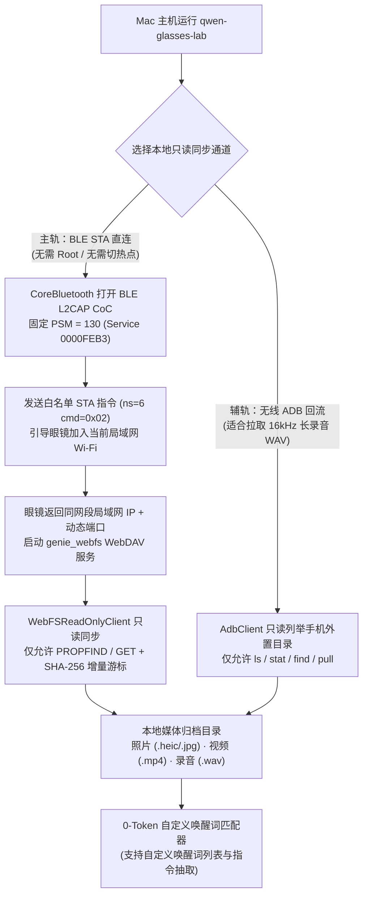

# Qwen AI Glasses Local Sync Kit — 开源使用手册

> **开源定位**：一套面向 **千问 AI 眼镜 G1** 的跨平台（macOS 优先）本地只读互操作开发套件（`qwen-glasses-lab`，MIT License）。
> 无需 Root 手机、无需刷机改固件、无需依赖云端接口，即可通过 macOS 原生 `CoreBluetooth` + 局域网 STA WebDAV 或无线 ADB，安全只读增量同步眼镜中的照片、视频与 16kHz 录音，并提供可配置的端侧自定义唤醒词触发引擎。

---

## 1. 核心架构与工作链路



### 核心安全设计（Fail-Closed 默认拒绝）
1. **蓝牙指令白名单**：内置确定性拦截锁（`safety_guard.py`），**严格禁止**发送固件升级（`OTA = 18`）、关机重启（`SHUTDOWN = 21`）、产测（`FACTORY_TEST = 28`）以及一切未列入白名单的指令。
2. **WebDAV / ADB 只读锁**：仅允许 `PROPFIND`、`GET`、`HEAD`、`OPTIONS` 与 `adb pull`，物理阻断 `DELETE`、`PUT`、`MKCOL`、`MOVE`、`POST` 与 `rm`，确保**绝不删除或篡改眼镜与手机端原件**。
3. **凭据零落盘**：局域网 Wi-Fi 密码仅在单次同步内存中用于构造蓝牙指令帧，绝不写入配置文件、日志或游标文件。

---

## 2. 环境要求与快速安装

### 2.1 系统要求
- **操作系统**：macOS 13+（推荐 Apple Silicon，原生支持 `CoreBluetooth` `openL2CAPChannel`）
- **Python**：`>= 3.10`
- **Xcode Command Line Tools**：用于编译 macOS 原生 Swift 蓝牙桥接程序（`swiftc`）
- **可选（辅轨同步用）**：Android Platform-Tools（`adb`）

### 2.2 安装 Python 套件
```bash
git clone https://github.com/iamtmac/qwen-glasses-lab.git qwen-glasses-lab
cd qwen-glasses-lab
python3 -m venv .venv
source .venv/bin/activate
pip install -e .
```

### 2.3 编译 macOS 原生蓝牙桥接（`.app` 封装以适配 macOS 蓝牙权限）
```bash
cd swift_bridge
xcrun swiftc -O GlassesBleBridge.swift \
  -framework CoreBluetooth -framework CryptoKit -framework Security \
  -o GlassesBLEBridge.app/Contents/MacOS/glasses-ble-bridge
cp Info.plist GlassesBLEBridge.app/Contents/Info.plist
cp GlassesBLEBridge.app/Contents/MacOS/glasses-ble-bridge ./glasses-ble-bridge
codesign --force --deep --sign - --identifier com.open.qwen-glasses-lab.ble-bridge GlassesBLEBridge.app

# 验证编译与安全白名单自检（不会触发蓝牙扫描）
./glasses-ble-bridge --check-spec
```

---

## 3. 全量可配置选项一览（`config.json` 与环境变量）

本套件通过 `GlassesKitConfig` 提供 **4 大类、共 19 项可配置参数**，支持 JSON 配置文件加载与环境变量覆写。

### 3.1 完整配置文件示例（`glasses_config.json`）
```json
{
  "device_display_name": "Qwen Glasses G1",
  "device_name_prefix": "Qwen Glasses",
  "target_mac": "",
  "target_pid": 0,
  "preferred_ssid": "Your-Office-5G",
  "bridge_binary_path": "./swift_bridge/glasses-ble-bridge",
  "adb_binary_path": "./tools/platform-tools/adb",
  "adb_serial": "",
  "storage_dir": "./synced_media",
  "wake_word": {
    "enabled": true,
    "wake_words": ["Assistant", "小助手"],
    "case_sensitive": false,
    "strip_leading_punctuation": true
  },
  "sync_policy": {
    "primary_mode": "ble_sta",
    "sta_frequency_mhz": 5220,
    "sta_business_id": 3,
    "sta_wifi_type": 1,
    "ble_timeout_seconds": 30,
    "webfs_root_path": "/DCIM/AliCamera",
    "allowed_extensions": [".jpg", ".jpeg", ".heic", ".mp4", ".wav", ".pcm", ".json"],
    "readonly_enforced": true
  }
}
```

### 3.2 配置项详细说明

| 分类 | 字段名 | 默认值 | 说明 |
| :--- | :--- | :--- | :--- |
| **设备识别** | `device_display_name` | `"Qwen Glasses G1"` | 控制台或日志中展示的设备名称 |
| **设备识别** | `device_name_prefix` | `"Qwen Glasses"` | BLE 扫描时的广播名称前缀过滤 |
| **设备识别** | `target_mac` | `""` | 指定目标设备蓝牙 MAC（多副眼镜共存时精准锁定） |
| **设备识别** | `target_pid` | `0` | 指定设备产品 ID（`0` 表示自动从广播解析） |
| **通道与存储** | `preferred_ssid` | `""` | 默认局域网 Wi-Fi 名称（**密码仅运行时临时传入，不落盘**） |
| **通道与存储** | `bridge_binary_path` | `""` | macOS 原生 Swift 蓝牙桥接程序路径 |
| **通道与存储** | `adb_binary_path` | `""` | 本机 `adb` 可执行文件路径（用于辅轨录音/相册同步） |
| **通道与存储** | `adb_serial` | `""` | 多台安卓设备同时连接时指定目标序列号或 `IP:Port` |
| **通道与存储** | `storage_dir` | `"./synced_media"` | 媒体本地归档与游标存储根目录 |
| **自定义唤醒词** | `wake_word.enabled` | `true` | 是否开启端侧软唤醒词检测 |
| **自定义唤醒词** | `wake_word.wake_words` | `["Assistant", "小助手"]` | 自定义中英文唤醒词列表（支持多别名，长词优先匹配） |
| **自定义唤醒词** | `wake_word.case_sensitive` | `false` | 英文唤醒词是否区分大小写（默认忽略大小写并校验词边界） |
| **自定义唤醒词** | `wake_word.strip_leading_punctuation` | `true` | 提取指令正文时是否自动剔除唤醒词后的逗号、冒号与空格 |
| **同步策略** | `sync_policy.primary_mode` | `"ble_sta"` | 默认主同步通道：`ble_sta`（局域网直连）或 `adb`（无线 ADB） |
| **同步策略** | `sync_policy.sta_frequency_mhz` | `5220` | 路由器 Wi-Fi 信道频点（5GHz 如 `5180`/`5220`，2.4GHz 如 `2437`） |
| **同步策略** | `sync_policy.sta_business_id` | `3` | 局域网 STA 配网业务 ID（默认 `3` 对应标准文件传输） |
| **同步策略** | `sync_policy.sta_wifi_type` | `1` | STA 模式标识（`1` 为常规路由器接入） |
| **同步策略** | `sync_policy.ble_timeout_seconds` | `30` | 蓝牙扫描与 STA 联网等待超时（允许范围 `10~120` 秒） |
| **同步策略** | `sync_policy.webfs_root_path` | `"/DCIM/AliCamera"` | 眼镜端 WebDAV 挂载根目录（旧固件可设为 `"/"`） |
| **同步策略** | `sync_policy.allowed_extensions` | `[".jpg", ...]` | 按后缀名白名单过滤需要拉取的媒体类型 |
| **安全保护** | `sync_policy.readonly_enforced` | `true` | 恒定只读锁（由代码强制锁定，无法通过外部配置关闭） |

### 3.3 支持的环境变量覆写
- `QWEN_GLASSES_WAKE_WORDS`：逗号分隔覆写自定义唤醒词列表，例如 `export QWEN_GLASSES_WAKE_WORDS="Jarvis,小智"`
- `QWEN_GLASSES_PREFERRED_SSID`：覆写默认局域网 Wi-Fi 名称
- `QWEN_GLASSES_BLE_KEY`：可选，仅在需要测试本地 HMAC 认证（`--auth-local`）时通过内存注入，切勿写入仓库

> **关于自定义唤醒词的硬件边界说明**：眼镜硬件芯片（DSP）内置的出厂离线唤醒词固化在只读固件中，非刷机无法替换。本套件提供的自定义唤醒词工作在**端侧音频/转写流层**（0-Token 确定性词边界匹配），可与任意本地 ASR（语音转文字）引擎或 AI Agent 无缝对接。

---

## 4. 快速上手使用指南

### 4.1 主轨：Mac 蓝牙一键唤醒局域网 STA + WebDAV 只读拉图
> **前置动作**：确保眼镜已开机放在 Mac 旁边，并**临时关闭已配对手机的蓝牙开关 20 秒**（无需在 App 中解绑，仅防止眼镜因被手机独占而停止 BLE 广播）。

```python
import getpass
from pathlib import Path
from qwen_glasses_lab import GlassesKitConfig, sync_via_ble_sta

cfg = GlassesKitConfig.load(Path("glasses_config.json"))
wifi_pass = getpass.getpass("请输入当前局域网 Wi-Fi 密码（仅本次生效，不保存）: ")

summary = sync_via_ble_sta(
    cfg,
    ssid=cfg.preferred_ssid or "Your-Office-5G",
    password=wifi_pass,
)
print("同步成功:", summary.ok)
print("新增下载:", len(summary.downloaded), "幂等跳过:", len(summary.skipped))
```

### 4.2 辅轨：无线 ADB 只读拉取手机端 16kHz 录音与历史相册
眼镜的长录音以 `16 kHz / 单声道 / 16 bit PCM`（`final.wav`）格式经蓝牙同步至手机外置目录，可通过无线 ADB 零 Root 增量归档到 Mac：

```bash
# 1. 连接开启了「无线调试」的安卓手机
./tools/platform-tools/adb connect <手机局域网IP>:<无线调试端口>

# 2. 预演扫描（不写磁盘）
python -m qwen_glasses_lab.adb_media_sync --dry-run --limit 10

# 3. 执行只读增量同步（自动写入 SHA-256 游标，二次运行 100% 跳过）
python -m qwen_glasses_lab.adb_media_sync --limit 20
```

### 4.3 使用端侧自定义唤醒词触发器
```python
from qwen_glasses_lab import WakeWordConfig, detect_wake_word

ww_cfg = WakeWordConfig(wake_words=["Jarvis", "小智"])
res = detect_wake_word("Jarvis，把刚才拍的白板照片整理成待办", ww_cfg)

if res.matched:
    print("命中唤醒词:", res.wake_word)       # Jarvis
    print("纯净指令正文:", res.command_text)   # 把刚才拍的白板照片整理成待办
```

---

## 5. 常见排查与避坑指南

| 现象 | 常见原因 | 解决方法 |
| :--- | :--- | :--- |
| Mac 扫描不到眼镜 | 眼镜正连接着手机，停止了 BLE 广播 | 临时关闭手机蓝牙 20 秒（不用解绑），再执行扫描 |
| 首次运行蓝牙桥闪退 (`SIGABRT`) | macOS 26 蓝牙 TCC 权限绑定责任进程 | 通过已签名的 `GlassesBLEBridge.app` 在系统终端中启动一次完成授权 |
| `ns=2 cmd=0x04` 返回 `succeed=12` | 把 P2P 热点指令错发给了普通路由器 | 改用 STA 指令 `ns=6 cmd=0x02`（`sync_via_ble_sta` 已默认使用该路径） |
| 局域网连不上动态端口 | 眼镜与 Mac 未处于同一子网，或 SSID 大小写有误 | 核对 SSID 大小写与频点（5GHz 信道号 × 5 + 5000 = MHz） |
| 找不到长录音文件 | 长录音不存放在 WebDAV `/DCIM/AliCamera` | 使用辅轨 `adb_media_sync` 从手机外置 `ai_record/` 目录只读拉取 `final.wav` |

---

## 6. 单元测试与合规声明

运行全套离线协议、安全门禁与唤醒词单元测试（无需连接真实眼镜，耗时 `<0.1s`）：

```bash
PYTHONPATH=src pytest tests/test_protocol_and_guards.py -v
```

> **合规声明**：本项目仅供个人对自己合法拥有的硬件设备进行本地数据备份与互操作研究使用。请严格遵守只读边界，切勿用于任何未经授权的第三方设备访问或商业滥用。
