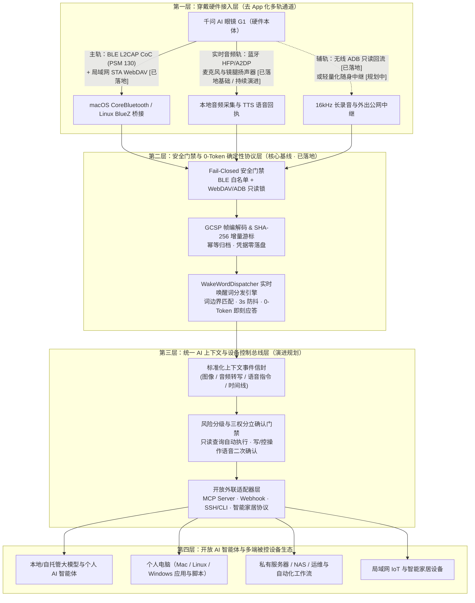

# Qwen AI Glasses Local Sync Kit 产品设计蓝图

> **文档定位**：本文档为开源项目 `qwen-glasses-lab` 的顶层产品蓝图与技术演进纲领（当前已落地基线：**v0.2 本地双轨只读同步与端侧自定义唤醒词闭环**；演进规划：**直连服务器边缘网关、统一 AI 上下文总线、跨设备 MCP/IoT 受控执行与随身中继形态**）。系统阐明如何将千问 AI 眼镜 G1 从“绑定封闭手机 App 的蓝牙外设”，升级为**去 App 化、直连电脑与服务器、可跨设备协同的个人第一视角 AI 上下文助手**。

---

## 一、核心产品价值总纲

### 1. 一句话定位

**`qwen-glasses-lab` 是面向千问 AI 眼镜 G1 的开源「去 App 化本地直连底座与第一视角 AI 上下文网关」——在不刷机、不 Root 手机的前提下，让眼镜摆脱封闭手机 App 的围墙，直接连接你的电脑、家庭/企业服务器与本地 AI 智能体，以“看你所看、听你所听、直控万物”的方式，把一副消费级 AI 眼镜升级为全天候随身的跨设备 AI 上下文助手。**

---

### 2. 智能眼镜沦为“封闭玩具”的四大结构性痛点

当前消费级 AI 眼镜普遍拥有出色的摄像头、麦克风阵列与第一视角交互形态，但在真实工作与生活流中往往沦为“拍完即忘、只能查天气”的浅层玩具，根源在于四道结构性堵点：

1. **被封闭手机 App 锁死（通道垄断）**：眼镜必须强绑定原厂闭源手机 App，照片、视频与 16kHz 长录音沉淀在厂商私有目录与云端孤岛中，无法直接流入开发者的电脑、私有服务器或自托管知识库；
2. **上下文与数字大脑割裂（记忆孤岛）**：用户眼前看到的白板、巡检铭牌、合同条款与耳边听到的真实对话，无法实时汇入自己正在使用的 AI Agent（智能体）与个人知识体系，导致 AI 依然“盲人摸象”；
3. **云端强依赖与隐私出域顾虑（数据失主）**：大量高敏会议录音、研发白板照片与私人对话默认流经公有云中转，个人与企业级用户难以放心在核心工作场景长期佩戴；
4. **“只答不干”的设备控制断层（手脚残缺）**：原厂语音助手停留在单轮封闭问答，无法直连你的电脑、家庭/办公服务器、代码仓库或局域网智能家居设备，听懂了却办不了事。

---

### 3. 四大核心价值支柱

| 价值支柱 | 核心承诺 | 为用户与开发者带来的真实改变 |
| :--- | :--- | :--- |
| **一、去 App 化本地直连** *（绕过封闭围墙，直通电脑与服务器）* | **眼镜直接对话你的计算节点** | 通过标准 `BLE L2CAP CoC (PSM 130)` + 局域网 `STA WebDAV` 直连，眼镜无需经过厂商云端与手机 App 中转，即可将第一视角照片、视频与语音流直接投递至你的 Mac、Linux 服务器或私有 NAS。 |
| **二、第一视角统一 AI 上下文总线** *（看你所看，听你所听，沉淀活体记忆）* | **让任意 AI 助手拥有物理世界感官** | 将零散的第一视角图像、16kHz 现场录音与语音指令标准化为高信噪比结构化上下文（带时间线、幂等指纹与媒体引用），开放对接任意本地/自托管大模型、个人笔记库或工作流引擎，不绑定单一模型厂商。 |
| **三、0-Token 下沉与三元科学分工** *（确定性归代码、理解归 AI、拍板归人类）* | **省算力、零幻觉、毫秒级可控** | 协议编解码、SHA-256 增量去重、硬件安全白名单、自定义唤醒词词边界匹配与防抖冷却全部通过 **0-Token 下沉**（由确定性代码直接执行，算力消耗归零、不依赖大模型波动）完成；非结构化多模态理解与任务规划交给 AI；高危设备控制终审权归还人类。 |
| **四、Fail-Closed 硬件安全与数据主权** *（零刷机、零变砖、100% 本地不出域）* | **守住硬件安全底线与个人隐私边界** | 默认拒绝一切未知与危险蓝牙指令（物理锁死固件升级 `OTA`、关机重启与产测命令），媒体同步默认只读绝不删改原件，Wi-Fi 密码与设备密钥零落盘，全部数据 100% 留存在用户自有算力底座内。 |

---

### 4. 权威产业趋势与工程共识支撑

本蓝图的架构设计顺应近两年端侧 AI 与个人智能体领域的三项核心工程共识：

| 核心设计原则 | 产业与前沿工程共识 | 对本项目的直接指导 |
| :--- | :--- | :--- |
| **0-Token 下沉（确定性归代码，模糊语义归 AI）** | **Anthropic**《Building Effective Agents》& **OpenAI**《AI Agents 实践指南》 | 唤醒词触发、防抖去重、协议白名单、只读文件同步与权限拦截必须由确定性代码 100% 兜底，大模型仅在真正命中指令或需要语义蒸馏时按需介入，兼顾低延迟、低成本与确定性可控。 |
| **多模态第一视角上下文优先** | **穿戴式 AI 与个人上下文引擎演进趋势** | 决定 AI 助手实用性的瓶颈早已不是底层模型智商，而是“能否低摩擦获取用户此刻所见所闻的真实上下文”。眼镜是人类唯一天然免手持的第一视角感官入口。 |
| **开放协议与标准化工具控制总线** | **MCP（Model Context Protocol，模型上下文协议）** 与开放自托管生态 | 拒绝再造封闭烟囱：通过标准化的事件总线与外联适配器（MCP / Webhook / CLI / 智能家居协议），让眼镜采集的意图能够安全、跨平台驱动电脑、服务器与周边设备。 |

---

### 5. 生态位边界与五大第一性原理

#### 生态位对比

| 对比维度 | 原厂封闭手机 App | 民间刷机/魔改固件方案 | 通用云端语音助手 | **`qwen-glasses-lab` 本地直连与 AI 上下文网关** |
| :--- | :--- | :--- | :--- | :--- |
| **硬件风险** | 低（官方维护） | 极高（易变砖、失保修） | 无硬件直连 | **零刷机风险（Fail-Closed 白名单只读互操作）** |
| **连接自由度** | 强绑定手机与厂商云 | 依赖破解漏洞，升级即失效 | 需手动上传文件/打字 | **直连 Mac / 服务器 / 边缘网关，摆脱 App 锁死** |
| **AI 生态开放性** | 锁定单一封闭模型 | 维护成本高 | 无第一视角持续上下文 | **开放对接任意本地/云端 LLM、Agent 与知识库** |
| **跨设备控制力** | 仅限有限手机功能 | 极客定制 | 无法触达局域网设备 | **经标准 MCP / Webhook / CLI 受控驱动电脑与服务器** |
| **隐私与数据主权** | 经厂商云端中转 | 视魔改来源而定 | 敏感数据需出域 | **100% 本地/私有服务器不出域，凭据零落盘** |

#### 五大产品设计第一性原理

1. **硬件安全红线高于一切（Fail-Closed）**：未知蓝牙命令一律拒绝，绝不碰 OTA、关机与产测命名空间；媒体同步强制只读，绝不删除眼镜原件。
2. **上下文优先律**：核心价值不是“再做一个聊天框”，而是把眼镜采集的视觉帧、现场音频与语音意图无损转化为任意 AI 系统可直接消费的结构化上下文。
3. **0-Token 确定性下沉律**：只要能用协议状态机、哈希游标、词边界匹配与冷却锁解决的问题，绝不消耗 1 个 Token。
4. **外联适配器解耦律（Host-First）**：`qwen-glasses-lab` 永远保持纯净、中立、零业务绑定的开源内核；具体对接哪款大模型、哪套笔记软件、哪台服务器或哪套智能家居系统，一律作为标准外联适配器（Adapter）插拔接入。
5. **跨设备控制三权分立（感知 ➔ 确认 ➔ 受控执行）**：眼镜负责第一视角感知与意图采集，策略门禁负责风险分级与语音二次确认，外联执行器负责受控落地，杜绝误唤醒引发破坏性操作。

---

## 二、从“蓝牙外设”到“AI 上下文助手”的三大核心场景

1. **第一视角实时上下文沉淀（所见即所记）**：
   - 开会拍下白板、现场巡检拍下仪表盘或设备铭牌、随身录下 16kHz 讨论音频；
   - 眼镜在局域网内自动将新增媒体增量同步至电脑或私有服务器，经本地视觉理解与语音转写后，自动结构化沉淀进你的个人知识库、待办系统或 AI 长期记忆，全程无需掏出手机手动导出。
2. **去 App 化直连电脑与服务器（免手机中转）**：
   - 回到办公室或家中，眼镜直接通过蓝牙唤醒局域网 Wi-Fi 与你的 Mac、Linux 迷你主机或树莓派边缘网关握手；
   - 电脑端或服务器端的常驻守护进程自动完成媒体归档、语音流监听与自定义唤醒词应答，彻底摆脱对封闭手机 App 的依赖。
3. **第一视角跨设备自然语言控制（开口即执行）**：
   - 戴着眼镜喊出自定义唤醒词（如 `Jarvis，查一下测试服务器磁盘占用` 或 `小助手，把刚才拍的白板照片转成任务清单发到项目群`）；
   - `WakeWordDispatcher`（0-Token 唤醒词实时分发引擎）在毫秒级完成词边界匹配与防抖过滤，将纯净指令正文路由至标准 MCP / Webhook / CLI 执行适配器，安全驱动电脑应用、远端服务器运维查询、构建流水线或局域网智能家居设备，并通过镜腿扬声器语音回执执行结果。

---

## 三、全栈技术架构与核心机理

### 1. 四层解耦全景架构（纵向分层）

### 2. 从第一视角流水到「仿生海马体大脑与知识星云」（三层记忆精馏漏斗）

为避免眼镜持续采集的照片与 16kHz 录音沦为“塞满硬盘却搜不到重点的噪音堆”，本蓝图在上下文总线层确立**三层仿生记忆精馏机制**：

1. **原始多模态感知流水（情景缓冲）**：白板照片、巡检视频与 16kHz 现场录音经 BLE STA / ADB 自动增量归档，支持原始音频按天滚动清理或阅后即焚，最大限度降低存储与隐私暴露面；
2. **0-Token 密度轻筛（脊髓反射层）**：通过 SHA-256 幂等去重、静音/寒暄切片与确定性信息密度评分，0-Token 滤除大部分低价值环境噪音，仅让高信噪比片段进入深度精馏；
3. **闲时海马体记忆巩固 ➔ 知识星云图谱**：在午休或夜间等算力低谷期批量执行记忆巩固，将碎片对话与白板内容提炼为可演化、可溯源的**立体知识星云**（串联「人物—项目—事件—原始证物哈希」四维关联），将 GB 级原始流水压缩为 MB 级高密度活体记忆，随时供任意开源 AI Agent 秒级上下文召回。

### 3. 硬件物理边界诚实声明（不画大饼，直面物理约束）

为保障开源社区清晰预期，明确当前硬件层的两项物理边界及对应工程解法：

1. **硬件芯片离线唤醒词不可无刷机改写**：千问眼镜 G1 机内低功耗语音芯片（DSP）固化的离线唤醒词（“你好千问”）位于只读固件中，非刷机无法替换。本套件通过 **「蓝牙音频通道 + 端侧实时 ASR（语音转文字）+ 0-Token `WakeWordDispatcher`」**，在零刷机、零变砖风险前提下实现任意中英文自定义唤醒词与实时指令分发。
2. **纯户外脱离电脑场景的物理链路**：在办公室/家中（有电脑或局域网边缘服务器）可完全脱离手机直连运行；若纯户外仅佩戴眼镜且远离局域网，因眼镜自身不具备蜂窝移动网络模块，需借助极轻量的开源随身中继（手机端仅作纯透传网关，不经过厂商封闭 App）将数据回传至个人服务器。

---

## 四、分阶段演进路线图（严格区分基线与规划）

| 阶段版本 | 状态 | 核心能力边界 | 关键交付物 |
| :--- | :--- | :--- | :--- |
| **v0.2 独立开源基线** | **已落地（Live）** | macOS 原生 BLE L2CAP `PSM 130` 直连、局域网 STA WebDAV 只读拉图、无线 ADB 16kHz 录音回流、Fail-Closed 安全白名单、19 项声明式配置、`WakeWordDispatcher` 实时唤醒词分发闭环（含防抖冷却、0-Token 应答与单测）。 | `src/qwen_glasses_lab/`、`swift_bridge/`、`tests/`、`OPEN_SOURCE_USER_MANUAL.md` |
| **v0.3 近端实时上下文引擎** | **近期规划** | 本地实时蓝牙音频流采集 + 可插拔开源流式 ASR（如 Whisper / SenseVoice 等通用本地引擎）对接 `WakeWordDispatcher`；输出标准化 JSONL / Webhook 上下文事件流，开箱对接任意本地 AI 助手与知识库。 | `audio_stream_bridge`、`context_event_bus`、Webhook 适配器 |
| **v0.4 服务器直连与跨设备控制** | **中期规划** | 扩展 Linux（BlueZ）蓝牙桥接，支持部署在家庭服务器、NAS 或树莓派边缘网关（无需开电脑，眼镜进局域网自动同步与待命）；内置标准 MCP 客户端/服务端与分级确认门禁，安全控制电脑应用、服务器脚本与局域网 IoT 设备。 | `linux_bluez_bridge`、`mcp_device_router`、风险分级策略引擎 |
| **v1.0 全天候随身上下文闭环** | **远期愿景** | 极简开源随身中继客户端（仅负责蓝牙音频/控制信道加密透传至用户自托管服务器），彻底打通“室内直连服务器 + 室外加密回传”的全天候、去封闭 App 化 AI 上下文助手闭环。 | 开源轻量化随身中继协议与参考实现 |

---

## 五、安全治理、数据主权与社区开源契约

1. **三条不可逾越的硬件与数据红线**：
   - **硬件零破坏**：严禁合入任何触发固件刷写（`OTA`）、强制关机重启或产测模式的代码分支；
   - **数据默认只读**：所有媒体同步默认只读拉取（`PROPFIND / GET / adb pull`），严禁静默删除眼镜或手机端原件；
   - **隐私与凭据零泄露**：Wi-Fi 密码、设备静态密钥、真实设备 MAC 与个人生物特征数据严禁落盘配置文件或提交至公开仓库。
2. **跨设备控制分级授权契约（面向 v0.4+ 控制能力）**：
   - **L1 只读查询类**（查天气、查服务器负载、查日程、检索笔记）：命中自定义唤醒词后直接自动执行并语音回执；
   - **L2 状态变更类**（开关局域网灯光、创建待办、发送草稿）：执行前记录可审计日志，支持用户按场景配置是否需语音确认；
   - **L3 高危操作类**（重启服务、执行写删命令、对外发送消息）：强制要求语音二次口令确认或桌面端手动审批，严禁单次语音误触发直接放行。
3. **开源协议与合规边界**：本项目基于 **MIT License** 开源，仅供个人与研究者对自己合法拥有的硬件设备进行本地数据备份、上下文集成与跨设备互操作探索，严禁用于未经授权的第三方设备访问。
